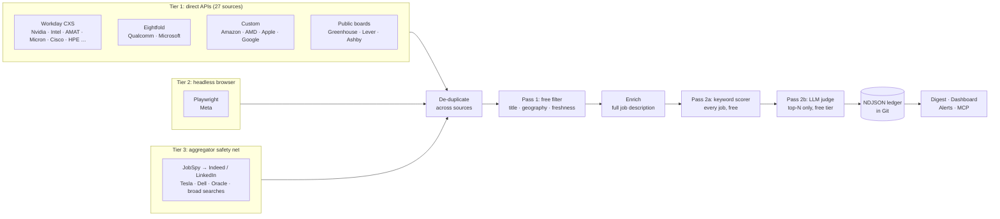

# Job Scout: a zero-cost job intelligence agent

[](https://github.com/Nainil30/Job_agent/actions/workflows/ci.yml)
[](https://github.com/Nainil30/Job_agent/actions/workflows/scout.yml)


Job Scout runs every morning on GitHub Actions. It checks **35 job sources** (company career sites, startup job boards, a headless browser, and LinkedIn/Indeed) for **NPI, materials program management, supply-chain and hardware TPM** roles. It filters and ranks what it finds against my profile, then publishes a ranked digest and a searchable dashboard.

**It finds and ranks jobs. It never applies on my behalf.** Applying stays a human decision.

> **[Latest digest →](digests/latest.md)**  ·  Dashboard: `https://nainil30.github.io/Job_agent/` (after enabling Pages, see [Automation](#automation-github-actions))

---

## The problem

Specialized hardware-operations roles are spread across dozens of career sites, and each one is built differently:

| Site type | Example | Why it's hard |
|---|---|---|
| Enterprise ATS (Workday, Eightfold, iCIMS) | Nvidia, Intel, Qualcomm, AMD | Each has its own private JSON API; tenant URLs change |
| Custom career sites | Apple, Google, Amazon | Undocumented, and they get redesigned. Google's old API now returns 404 |
| JavaScript-only sites | Meta | No data until the page is rendered in a browser |
| Bot-protected sites | Tesla | Blocks automated browsers outright (Akamai) |
| Aggregators | LinkedIn, Indeed | Postings appear 1–3 days late, with lots of noise |

My first version only handled two of these well. The fix wasn't "use browser automation everywhere". It was to **pick the cheapest reliable method per site, and make failures visible**.

## How it works



### 1. Tiered ingestion: browser automation as a last resort

I first asked whether the answer to "sites it can't read" was to run a browser automation script against all of them. Usually it isn't. Browsers are slow, break whenever CSS class names change, and get blocked. Most career sites that look JavaScript-only actually load their data from a JSON endpoint, or embed it in the HTML. So each source uses the cheapest method that works:

- **Tier 1: structured data, no browser.** Workday, Eightfold, Jibe, Amazon, Greenhouse, Lever, and Ashby all have JSON APIs. **Apple** and **Google** were "broken" in v1. Their server-rendered pages turn out to embed the full results as JSON (`__staticRouterHydrationData` and `AF_initDataCallback`), so the agent parses that directly. All 27 Tier-1 sources finish in about 30 seconds.
- **Tier 2: headless Chromium (Playwright).** Only for sites that truly need it (Meta). The adapter is **config-driven**: a URL template plus a link selector (`a[href*='/job_details/']`). Link selectors are much more stable than class-name selectors.
- **Tier 3: the aggregator safety net (JobSpy).** Tesla's site blocks automated browsers. The agent **doesn't try to get around that**. Tesla's roles are syndicated to Indeed and LinkedIn, so the aggregator tier collects them there, and broad searches catch companies I haven't listed.

When the same role appears in several tiers, the pipeline **keeps the direct listing** and drops the aggregator copy, using a fingerprint of company + normalized title + city.

### 2. Two-pass evaluation keeps LLM usage within free quotas

About 9,500 listings come in per run, so sending all of them to an LLM isn't an option.

| Stage | What it does | Cost |
|---|---|---|
| **Pass 1: deterministic filter** | Title allow/block regexes, US-geography detection (state codes, names, country blocklist with word boundaries, so "India" doesn't match "Indiana"), company rules (Amazon must be Austin), freshness | Free. Drops about 95% |
| **Enrich** | Fetches the full description, only for jobs that survived Pass 1 | ~400 requests |
| **Pass 2a: keyword scorer** | Transparent 0–100 score from weighted keywords in `persona.yaml`. The matched keywords are stored as the explanation | Free, runs on every job |
| **Pass 2b: LLM judge** | Gemini / Groq / OpenRouter / Ollama score the **most promising jobs first**, up to a per-run budget and rate limit. Output is validated with Pydantic | Free tier |

Design choices worth noting:
- **The LLM doesn't decide the tier.** It returns a score; the code maps score to tier, so thresholds stay consistent. A deterministic guard caps any role whose description demands far more experience than I have.
- **No LLM key? It still works.** Every job gets a keyword score. If the LLM fails or hits a 429, the job falls back to the keyword score and the run never crashes.
- **Resume-bullet suggestions are grounded.** The prompt only allows my listed competencies and uses `[X%]` placeholders instead of invented metrics.

### 3. Source health turns silent failure into a visible signal

The v1 failure mode was "the site broke, so it found nothing, and I didn't notice." Now each source reports `ok / partial / empty / error / skipped` on every run, and failure streaks are tracked. The digest and dashboard show a health table. `python -m src.main doctor` tests every source without saving anything.

### 4. Git as the database

- `data/jobs_ledger.ndjson` holds one JSON record per role, sorted and written atomically. A line changes only when that role's evaluation or status changes, so daily commits stay small and reviewable.
- `data/seen_index.json` stores `{job: last_seen}`, which tracks whether a role is still live without rewriting the ledger.
- `MemoryDB` loads the ledger into in-memory SQLite for ad-hoc queries (used by the MCP server).

## Before and after

| | v1 | v2 (this version) |
|---|---|---|
| Sources returning jobs | 2 of 7 (Nvidia, Amazon) | **35 of 35** (27 API · 1 browser · 7 aggregator searches) |
| Apple / Google | Broken (401 / 404) | Fixed by parsing embedded page data |
| AMD / Qualcomm / Applied Materials | Broken (wrong endpoints) | Fixed: Jibe, Eightfold, corrected Workday tenant |
| Tesla, Meta | Stub that returned `[]` | Meta via Playwright, Tesla via aggregator |
| Jobs scored | **0 of 40** (LLM call failed silently) | All roles: keyword score always, LLM when a key is set |
| Job descriptions | Title only | Full description fetched for filtered roles |
| Failure visibility | None | Per-source health, streaks, `doctor` command |
| Repo hygiene | `.venv/` (11k files) and `.env` committed | Removed, `.gitignore` fixed |
| Tests | 2 files | 72 tests (adapters mocked with respx, end-to-end pipeline) + CI |

## Free stack

| Need | Choice | Cost |
|---|---|---|
| Scheduler and compute | GitHub Actions (public repo) | $0 |
| Storage | NDJSON in Git | $0 |
| Dashboard hosting | GitHub Pages | $0 |
| Headless browser | Playwright + Chromium | $0 (open source) |
| Aggregators | python-jobspy | $0 (open source) |
| LLM | Gemini free tier, Groq free tier, OpenRouter `:free`, or local Ollama | $0 |
| Alerts | Discord webhook, Telegram bot, ntfy.sh, or Gmail SMTP | $0 |

## Quick start

```bash
git clone https://github.com/Nainil30/Job_agent.git
cd Job_agent
python -m venv .venv
source .venv/bin/activate            # Windows: .\.venv\Scripts\Activate.ps1
pip install -r requirements-dev.txt
python -m playwright install chromium
cp .env.example .env                 # optional: add a free LLM key
```

```bash
python -m src.main doctor            # check every source, store nothing
python -m src.main run               # full pipeline → data/, digests/, site/
python -m src.main list --min-score 70
open site/index.html                 # the dashboard (Windows: start site\index.html)
```

### CLI

| Command | Purpose |
|---|---|
| `run [--tiers api,browser,aggregator] [--only nvidia,tesla] [--no-llm] [--no-notify]` | Run the pipeline |
| `doctor [--tiers …] [--only …]` | Health-check sources; prints listings and filter results per source |
| `report` | Rebuild the digest and dashboard from the ledger, no network |
| `list [--min-score N] [--company X] [--export file.txt]` | Ranked roles in the terminal |
| `mark <id> applied\|archived` | Track roles you applied to yourself |

## Configuration

Everything that's specific to me lives in two YAML files. Retargeting the agent to another person or role family means editing them, not the code.

**`config/companies.yaml`**: one entry per source.

```yaml
- name: Nvidia
  source: workday            # workday | eightfold | jibe | amazon | apple | google
  url: https://nvidia.wd5.myworkdayjobs.com/wday/cxs/nvidia/NVIDIAExternalCareerSite/jobs
  site_url: https://nvidia.wd5.myworkdayjobs.com/en-US/NVIDIAExternalCareerSite
  queries: ["Hardware Technical Program Manager", "NPI"]

- {name: Anduril, source: greenhouse, board: andurilindustries}   # | lever | ashby

- name: Meta
  source: browser
  url: "https://www.metacareers.com/jobs?q={query}"
  link_selector: "a[href*='/profile/job_details/']"
```

Adding a Workday company: open its careers page, copy the tenant and site name from the URL, and run `python -m src.main doctor --only <name>`.

**`config/persona.yaml`**: the candidate profile the LLM sees, plus the filter regexes, scoring keyword weights, location rules, and tier thresholds.

## Automation (GitHub Actions)

`.github/workflows/scout.yml` runs daily at 12:00 UTC (and on demand from the Actions tab, with tier and company inputs). Each run:
1. runs all three tiers, with Chromium installed and cached,
2. commits `data/` and `digests/`,
3. publishes `site/` to GitHub Pages.

One-time setup (all optional):

| Setting | Where | Purpose |
|---|---|---|
| `GEMINI_API_KEY` (or `GROQ_API_KEY` / `OPENROUTER_API_KEY`) | Settings → Secrets → Actions | LLM scoring |
| `DISCORD_WEBHOOK_URL` / `TELEGRAM_BOT_TOKEN` + `TELEGRAM_CHAT_ID` / `NTFY_TOPIC` / `SMTP_*` + `EMAIL_TO` | Secrets | Alerts for new roles at or above `NOTIFY_MIN_SCORE` |
| Pages source = **GitHub Actions** | Settings → Pages | Hosted dashboard |

`ci.yml` runs `ruff` and `pytest` on every push and PR.

> **Privacy note:** in a public repo, the ledger, digest, and dashboard are public. That's fine for job postings, but `persona.yaml` describes the candidate. Making the repo private keeps everything working (Actions gives 2,000 free minutes a month, and a run takes about 4), but GitHub Pages on a free plan requires a public repo.

## MCP server (Claude Desktop / Cursor)

```bash
pip install -r requirements-mcp.txt
python -m src.mcp.server
```

```json
{ "mcpServers": { "job-scout": { "command": "python", "args": ["-m", "src.mcp.server"], "cwd": "/path/to/Job_agent" } } }
```

Tools: `search_jobs`, `job_details`, `evaluate_job_description` (paste any job description), `source_health`, `mark_status`. For example: *"Show Austin roles above 75 I haven't applied to, and draft bullets for the top one."*

## Project layout

```
src/
├── adapters/          one class per source type; registry.py maps `source:` → class
│   ├── base.py        two-phase contract: fetch_jobs() listings → enrich() full description
│   ├── workday.py  eightfold.py  jibe.py  amazon.py  apple.py  google.py  boards.py
│   ├── browser.py     Tier 2: config-driven Playwright adapter
│   └── aggregator.py  Tier 3: JobSpy, serialized to respect rate limits
├── engine/
│   ├── filter.py      Pass 1: titles, US geography, freshness
│   ├── scorer.py      Pass 2a: transparent keyword scorer
│   ├── llm.py         provider-agnostic client (Gemini / Groq / OpenRouter / Ollama), rate limiter
│   └── evaluator.py   Pass 2b: LLM judge, tier mapping, fallbacks
├── storage/           ledger.py · health.py · reporter.py · dashboard.py · db.py
├── pipeline.py        orchestration, concurrency, cross-source de-duplication
├── notify.py          Discord / Telegram / ntfy / email
└── main.py            CLI
tests/                 72 tests: adapters (respx-mocked), filter, scoring, ledger, end-to-end pipeline
```

## Responsible-use notes

- **Read-only, low volume.** One run makes a few hundred polite requests spread across many hosts, with retry and backoff. That's about the same load as a person browsing.
- **No evasion.** The agent uses public endpoints and pages. It doesn't bypass CAPTCHAs or bot protection; blocked sites are covered through aggregators.
- **No auto-apply.** It ranks roles and drafts suggestions. Applying is up to me.
- Career-site endpoints are undocumented and can change. The health table exists so that breakage shows up quickly and can be fixed with a config change.

## Roadmap

- Resume-aware matching: embed my resume and score semantic similarity alongside keywords
- "Closed role" detection from last-seen gaps, plus time-to-close analytics per company
- Generic network-capture mode for the browser tier (record a site's own JSON calls, then replay them without a browser)

## License

MIT. See [LICENSE](LICENSE).
